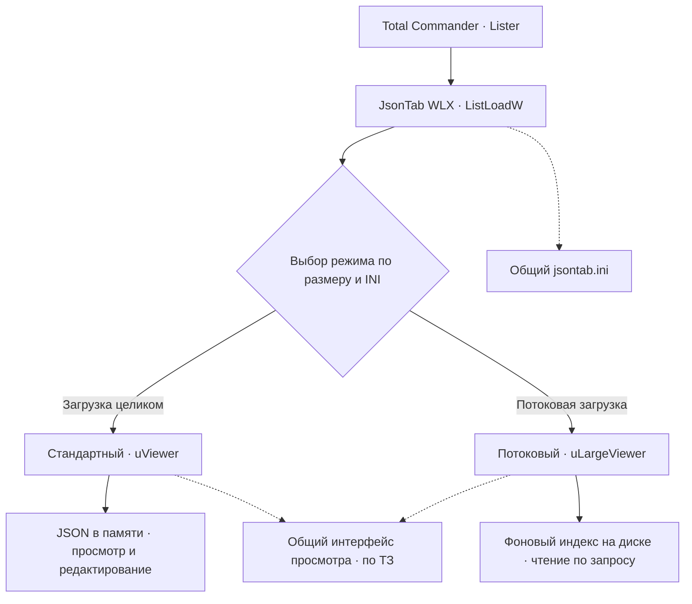

# ТЗ на интерфейс и настройки JsonTab для Total Commander

**База разработки** — принятая сборка v5, локальная ветка `feature/group-event-tree`, коммит `63764d0`. Целевая приёмка — Total Commander 11.55 x64. Разработка продолжается на Free Pascal. Плагин собирается как нативный WLX.

## 1. Согласованные превью

1. **Стандартный просмотр JSON и JSONL** — эталон компоновки дерева, таблицы, фильтра и шестерёнки.
2. **Общее окно настроек JsonTab** — эталон тёмного оформления, состава полей и двух кнопок рядом с путём к INI.

При реализации снять скриншоты стандартного просмотра и окна настроек в Total Commander и сопоставить каждый с соответствующим превью. Сверить порядок и расположение элементов, выравнивание, размеры кнопок, читаемость и контраст. Для светлой темы соблюдать ту же компоновку. Путь, значения полей и записи на макетах служат примерами. Размеры элементов подстраиваются под масштаб Windows и длину переведённых надписей.

## 2. Общий интерфейс стандартного и потокового просмотра

Оба модуля используют общий код интерфейса просмотра. Общий слой создаёт и размещает дерево, панель команд, фильтр, вкладки `Grid` и `Text`, строку состояния и вход в настройки. Он обрабатывает общие команды и получает данные, состояние и список доступных действий от текущего режима. Оба режима используют одну форму настроек и общий механизм локализации. Компоновка и поведение общих действий совпадают.

- За основу общей компоновки взять управление из потокового просмотра и согласованное превью. Слева над деревом разместить выбор `Group by`. Справа разместить вкладки `Grid` и `Text` и команду `Refresh`. Над таблицей разместить выбор поля, поле ввода фильтра и `Clear all`. Шестерёнку настроек поставить в правом верхнем углу над `Clear all`, в обоих режимах.
- Группировка по полю сохраняет действующие правила для JSONL и корневого массива JSON. Выбор `File order` возвращает исходный порядок. Пункт выбора поля доступен, когда текущие данные допускают группировку.
- Фильтр применяется после короткой паузы при вводе, как в v5. Условия по нескольким полям сочетаются. Очистка поля снимает его условие, `Clear all` снимает все условия. Проверить результат в `Grid` и `Text`, включая фильтрацию внутри выбранной группы. Сохранить поддерживаемые стандартным режимом операторы сравнения.
- `Refresh` в стандартном режиме перечитывает файл. При несохранённых правках предложить сохранить, отбросить или отменить обновление. В потоковом режиме использовать действующее обновление с учётом дописывания или замены файла.
- Доступность отдельных команд определяет текущий режим. Стандартный режим сохраняет редактирование и сортировку там, где они поддерживаются. Потоковый режим работает только на чтение, сохраняет порядок записей в файле, показывает ход индексации и добавляет навигацию по страницам или фрагментам в `Text`, когда она нужна. Поиск, навигацию и закрытие по `Esc` сохранить. Отличия отражать в общей компоновке по мере необходимости.

### Язык интерфейса во всех режимах

Весь интерфейс JsonTab следует языку активного профиля Total Commander. Это касается стандартного и потокового просмотра, общего окна настроек, вкладок, кнопок, контекстных меню, подсказок, строки состояния, предупреждений и ошибок, формируемых плагином. Использовать общий механизм локализации с русским и английским переводами. Если для языка Total Commander перевода нет, использовать английский. Отдельный переключатель языка не нужен. Названия полей и значения JSON, имена файлов и пути показывать как в источнике. Английские названия элементов в ТЗ и на превью служат ориентирами при сверке компоновки.

Для определения языка использовать `COMMANDER_INI`, если доступен, и читать `[Configuration] LanguageINI` активного профиля. Проверить обычный и переносимый профили.

## 3. Общее окно настроек

Одна форма для обоих режимов. Порядок секций и кнопок соответствует превью. Шестерёнка имеет локализованную подсказку «Настройки». На окно распространяются общие требования к языку интерфейса из раздела 2.

| Секция | Поле | Ключ в `[jsontab]` |
| --- | --- | --- |
| Внешний вид | Тема — как в Total Commander, светлая, тёмная | `theme-mode` |
| Внешний вид | Шрифт и размер текста. Применяются к дереву, таблице и вкладке `Text` обоих режимов | `font`, `font-size` |
| Фильтрация | Учитывать регистр | `filter-case-sensitive` |
| Большие файлы | Потоковый режим для файлов больше, в МиБ | `full-load-max-size` |
| Большие файлы | Предупреждать при открытии от, в МиБ | `large-file-warning-size` |

**Сохранить** проверяет значения и записывает изменённые поля в активный INI. Остальные параметры и комментарии сохранить. Тему, шрифт и правила фильтрации применить к открытому просмотру. Пороги действуют со следующего открытия файла. При ошибке записи форма остаётся открытой и показывает причину. **Отмена**, крестик и `Esc` закрывают форму без сохранения её изменений.

Размеры хранятся в байтах как положительные 64-битные целые числа. Преобразование между МиБ и байтами не должно терять точность сохранённого значения при изменении других полей. Файл на границе полной загрузки открывается стандартно, при превышении — потоково. Предупреждение появляется только при потоковом открытии, начиная с заданного размера включительно. По умолчанию — 5 МиБ и 1024 МиБ соответственно. Пересмотр порога предупреждения по рабочим логам остаётся отдельной задачей.

Для старого профиля с одним `max-file-size` показать в блоке больших файлов, что действует прежний лимит и потоковый режим отключён. Включать его только при явном задании нового порога полной загрузки. Сохранение темы, шрифта или фильтра не включает потоковый режим автоматически. Сохранить совместимость с `dark-theme` и остальными INI-ключами.

## 4. Путь к INI и две команды Total Commander

Внизу показать фактический путь, разрешённый плагином для чтения и записи. Поле доступно для выделения и копирования. Правее расположить две квадратные кнопки одинакового размера. Обе доступны с клавиатуры и имеют подсказки на языке окна.

| Порядок | Кнопка | Действие |
| --- | --- | --- |
| 1 | Папка — «Открыть папку настроек» | Открывает каталог активного INI в текущей вкладке активной панели того же экземпляра Total Commander. Другие вкладки и путь в другой панели сохраняются. Использовать штатный переход Total Commander с флагом `S`. |
| 2 | Файл с карандашом — «Редактировать INI» | Открывает точный путь к активному INI через Total Commander в редакторе, назначенном на F4. Проверить вызов `cm_Edit` с явным путём на 11.55 x64. Действие не должно зависеть от файла под курсором в панели. |

Обе кнопки выполняют только свою команду. Если INI ещё не создан, кнопка папки доступна при наличии каталога, а редактирование становится доступно после создания файла через «Сохранить». Если нужное действие нельзя выполнить через Total Commander, показать понятное сообщение. Проверить пути с пробелами и кириллицей.

## 5. Приёмка

| Проверка | Ожидаемый результат |
| --- | --- |
| Сверка с превью | Приложены два скриншота реализации. Сверены дерево и элементы управления, шестерёнка над `Clear all`, порядок секций, путь и две кнопки справа. Проверены светлая и тёмная темы, русский и английский, масштаб Windows 100% и 150%. |
| Оба режима | По коду проверить, что оба режима используют общий слой интерфейса. В обоих режимах на JSON и JSONL сверить порядок элементов и поведение группировки, фильтра, `Clear all`, `Refresh`, вкладок и шестерёнки. Проверить доступность редактирования и сортировки в стандартном режиме, ход индексации и постраничную навигацию в потоковом. |
| Локализация всего интерфейса | В каждом из двух режимов и в настройках проверить русский и английский интерфейс, включая меню, подсказки, статус, предупреждения и ошибки. Для языка без перевода проверить английский. Содержимое JSON отображается как в исходном файле. |
| Настройки и совместимость | Сохранённые поля восстанавливаются после повторного открытия. «Отмена» сохраняет старые значения. Проверены ошибки ввода и записи, старый INI, оба порога и файлы точно на границах. |
| Интеграция с TC | Кнопка папки меняет путь в текущей вкладке левой или правой активной панели. Число вкладок и путь другой панели сохраняются. Кнопка редактирования открывает тот же INI в настроенном F4-редакторе, в том числе после смены редактора. Проверить отдельно из Lister по F3 и из быстрого просмотра, если в нём доступна шестерёнка. |
| Регрессии v5 | Запустить существующие тесты и проверить поиск, редактирование стандартного просмотра, `Esc` в потоковом режиме и открытие потоком большого файла. |

## 6. Как устроен плагин

Total Commander загружает одну библиотеку JsonTab для своей разрядности. При открытии JSON или JSONL общая точка входа определяет подходящий режим. Стандартный и потоковый просмотр реализованы разными модулями внутри этой DLL.

При заданном `full-load-max-size` или при отсутствии обоих ключей выбора режима файлы до порога включительно загружаются целиком. При превышении порога выбирается потоковый просмотр. Если действует только прежний `max-file-size`, остаётся стандартный просмотр с правилами старого лимита. Потоковый модуль строит временный индекс записей в фоне и читает данные по запросу. В целевой реализации оба модуля подключаются к общему слою интерфейса, форме настроек и механизму локализации. Общий интерфейс получает от модуля данные, статус обработки и доступные действия.

**Результат разработки** — обновлённый исходный код, установочный архив x64, скриншоты для сравнения с превью и краткий итог проверок. Проверить компиляцию Win32 как существующей конфигурации проекта.